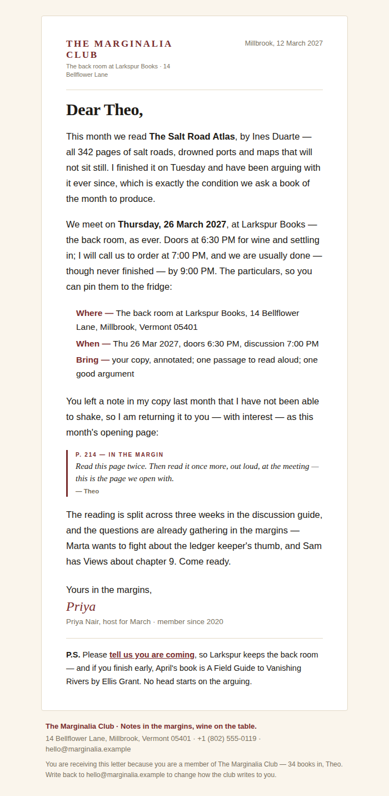
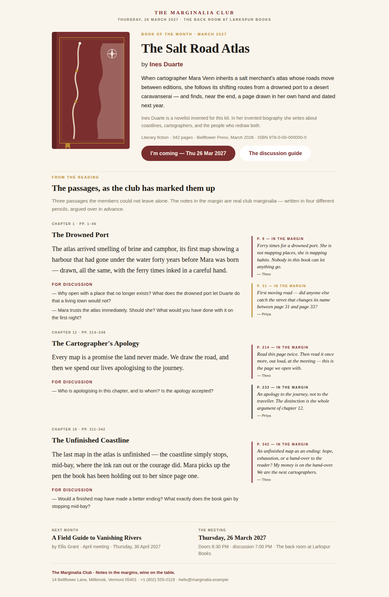
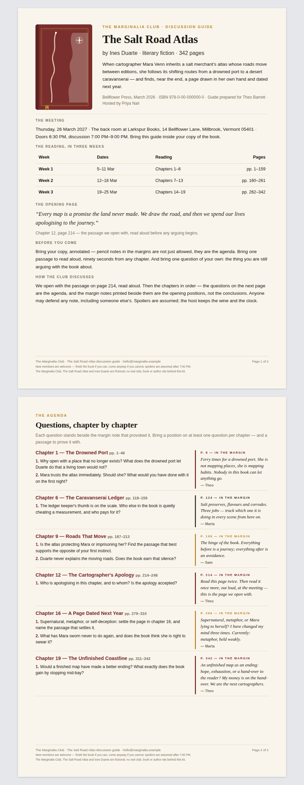
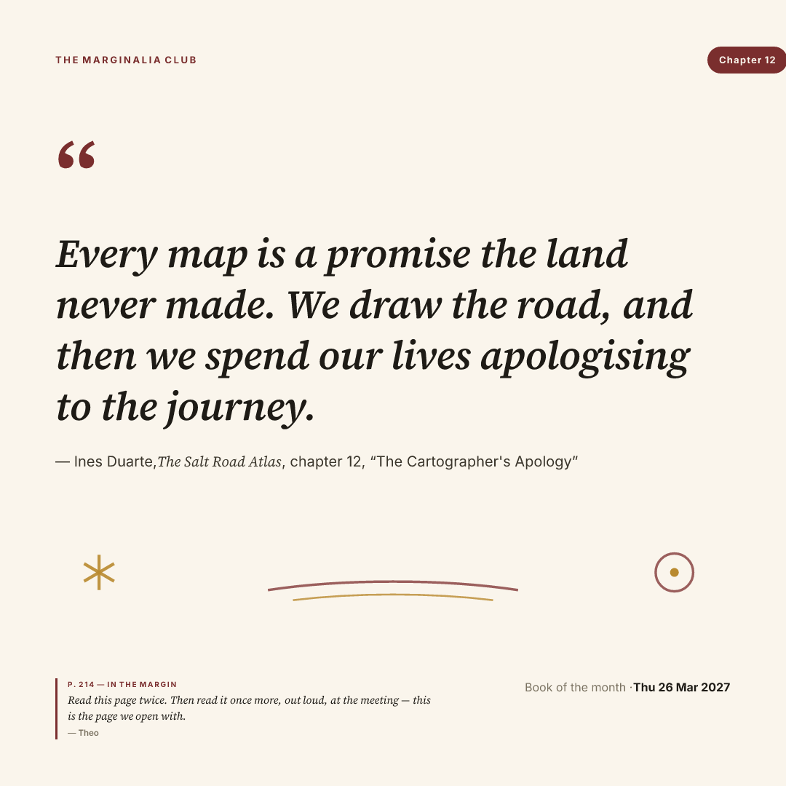

# Marginalia — a book club that writes in its books

The Marginalia Club meets monthly in the back room of a bookshop, and its
one rule is in the name: you must write in the book. This kit is the
club's paper trail for March 2027, when the book is *The Salt Road Atlas*
by Ines Duarte — a host's invitation letter, the novel presented as an
annotated page with the members' notes in its margins, a discussion
guide built from those notes and questions, and a card setting the
passage everyone will be arguing about.

The organising idea is the annotation itself. The source material is a
set of chapters; each chapter holds a passage, the margin notes members
left beside it, and the questions it has to answer for. Everything the
club sends is a different way of arranging passages and their notes.


## The four pieces

### The invitation letter



Not an announcement — a letter. Priya, this month's host, writes to
member Theo Barrett with a date line, a salutation and flowing
paragraphs; the time and place are set down mid-letter the way a person
actually writes them, one of Theo's own margin notes is quoted back at
him, and a postscript carries the RSVP. It renders to email HTML with a
plain-text twin, and the build checks it against classic Outlook, Gmail
and Apple Mail.

### The annotated page



The book of the month laid out the way the club reads it: the drawn
cover and the blurb first, then three passages in a wide serif column
with the members' notes sitting beside them in a true margin — four
pencils, four tempers — and each passage's discussion questions
underneath.

### The discussion guide



A two-page A4 booklet to fold into the book and bring on the night. The
first page is the apparatus: the book, the meeting, the three-week
reading schedule, how the club discusses. The second walks the chapters
in order — every question, with the margin note that provoked it printed
alongside as the opening position.

### The quote card



Chapter 12's apology, set large on warm paper, ringed with drawn pencil
marginalia — an asterisk, an underlined flourish, a circled mark — and
Theo's note on that page underneath. A passage, and what a reader wrote
back to it.

## How Hyper Elements was used

- **A custom element is the kit's centrepiece.** `src/elements.tsx`
  defines `MarginNote` with `defineElement()` (type
  `marginalia.MarginNote`): typed props for the page marker, the note
  text, its author and a pencil colour (`oxblood`, `gold` or `ink`), a size (`regular` or the guide’s `compact`), and
  a render that draws a pencil-coloured rule, the marker in small caps,
  the note in italic serif and the annotator's name. Because its render
  is built only from text primitives, the very same element appears in
  the letter as an inset quotation, in the page's margin column, beside
  the guide's questions, and under the quote card's passage.
- **Annotations are the data model.** `src/data.ts` is organised as
  chapters: each has a passage, an array of margin annotations and an
  array of discussion questions. The guide is generated by walking the
  chapters; the page selects three and sets their notes in the margin;
  the letter quotes one note back at its author; the card features the
  chapter the club opens with. Change a note in the data and it moves
  everywhere the note appears.
- **One theme, in the club's colours.** `src/theme.ts` calls
  `defineTheme()` once — warm paper cream `#FAF5EC`, ink `#1E1B16`,
  oxblood `#7A2E2E` — with Source Serif 4 for display and Inter for
  body, a type scale per heading level, and a `formats.email` tightening
  for the inbox. The palette is exported as values, so the drawn artwork
  uses the same hexes as the tokens.
- **Every visual is drawn.** The novel's cover (cloth, gilt frame, a
  winding salt road, a compass rose, a bookmark ribbon) and the quote
  card's pencil doodles are `Svg` shapes built from the palette. There
  are no image files and nothing is fetched.
- **Validation is the build gate.** `scripts/build.tsx` runs
  `validate()` on all four templates and fails on any error; the letter
  is additionally validated with the `@hyper-elements/email-clients`
  plugin, whose per-client previews land in `out/clients/`. The current
  build is clean: **0 errors, 0 warnings**. (The plugin still reports
  info-level notes — classic Outlook squares the corners and most
  clients substitute the web fonts — which are graceful degradations,
  not defects.)

## Run it

```bash
npm install
npm run build        # validate + render everything into out/
npm run screenshots  # Playwright captures, into docs/screenshots/
npm run typecheck    # tsc --noEmit
```

Requires Node 20+. Outputs land in `out/`:

| File | What it is |
| --- | --- |
| `out/letter.html`, `out/letter.txt` | The invitation letter + plain-text twin |
| `out/annotated-page.html` | The annotated book page |
| `out/guide.html`, `out/guide.pdf` | The discussion guide, print HTML + PDF (A4, 2 pages) |
| `out/quote-card.png`, `out/quote-card.svg` | The quote card, 1080 × 1080 |
| `out/clients/*.html` | The letter as Outlook, Gmail and Apple Mail draw it |

## Make it yours

Rewrite the margins in `src/data.ts` — a different novel, different
chapters, notes in different pencils — and rebuild. The letter will
quote a different note, the page will set different passages in its
margin, the guide will ask different questions. To invent a new kind of
annotation, extend `MarginNote` in `src/elements.tsx`; every output
learns it at once.

## Project structure

```
src/
  data.ts            the chapters: passages, margin notes, questions
  theme.ts           defineTheme(): cream, ink, oxblood; serif + sans
  fonts.ts           local WOFF font files for the PDF and image engines
  elements.tsx       MarginNote (a defineElement() custom element),
                     the drawn BookCover, MarginDoodles, running head
  letter.tsx         the host's invitation letter (Email, 600px)
  annotated-page.tsx the book as an annotated page (Page, 960px)
  guide.tsx          the discussion-guide booklet (Document, A4)
  quote-card.tsx     the passage card (Canvas, 1080 x 1080)
scripts/
  build.tsx          validate gate + all renders + email-client previews
  screenshot.ts      Playwright captures for visual checks
docs/screenshots/    captures of the rendered outputs
docs/quote-card.svg  the quote card as SVG, for this README
out/                 build outputs (gitignored)
```

## Fonts

Source Serif 4 (display serif) and Inter (body), both under the SIL Open
Font License. No font files are committed: the families come from the
`@fontsource` npm packages — `src/fonts.ts` hands their WOFF files to
the PDF and image engines, and the HTML outputs reference the same
families as web fonts (Inter from Google Fonts, Source Serif 4 from the
`@fontsource` package via the jsDelivr CDN), so a build works offline
once installed apart from those webfont references in the HTML.

## Notes

- All names, businesses, books, prices and details in this kit are
  fictional sample data. The Marginalia Club, Larkspur Books,
  *The Salt Road Atlas*, Ines Duarte, Theo Barrett and every other
  member were invented for this template; the `.example` domain is
  reserved for exactly this.
- The passages quoted from *The Salt Road Atlas* were written for this
  kit. The real novel does not exist, which the club considers a loss.

## License

MIT — see [LICENSE](LICENSE). Fonts are under the SIL Open Font License.
